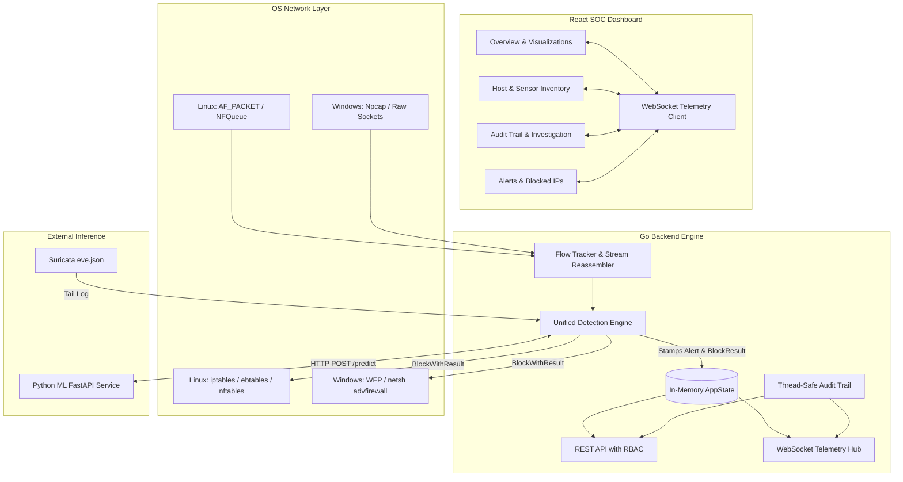

# IDPS: Real-Time Intrusion Detection and Prevention System


## Abstract
Nexus Enterprise IDPS is a production-grade, cross-platform Intrusion Detection and Prevention System engineered for high-throughput, low-latency network threat mitigation on both **Linux** and **Windows**. 

The system provides a unified detection engine with platform-specific networking adapters:
- **Linux Adapter**: Native AF_PACKET zero-copy ring buffer capture, Netfilter Queue (NFQueue) inline packet inspection, kernel `iptables`/`nftables` packet dropping, and Layer 2 `ebtables` MAC isolation.
- **Windows Adapter**: Npcap/WinPcap packet capture with raw socket fallback, Windows Filtering Platform (WFP) / native `netsh advfirewall` rule injection, and native TCP connection termination.
- **Verified Prevention**: Guarantees that no threat is marked as blocked until confirmed by the operating system's firewall kernel tables (`BLOCK_CONFIRMED`), with automatic rollback, TTL sweepers, and protected safety allowlists.
- **Enterprise SOC Dashboard**: A cyber-grade React SOC console providing live host telemetry, real packet metrics, verified alert actions, host inventory, and forensic audit investigation.

---

## 🌟 Key Capabilities

### 1. Unified Cross-Platform Architecture
* **Single Codebase**: Shared flow tracking, rule matching, behavioral heuristics, and ML inference with OS-native network drivers.
* **Linux Engine**: AF_PACKET ring buffer with fanout hashing; inline packet queuing via `libnetfilter_queue`.
* **Windows Engine**: Npcap NDIS 6 driver capture; native rule enforcement via `netsh advfirewall` (inbound/outbound); active flow termination via native Windows networking APIs.
* **Runtime Capability Detection**: Automatically probes elevated privileges (`os.Geteuid() == 0` on Linux, Windows Token Administrator check), available firewall subsystems, and capture drivers.

### 2. Suricata as Primary DPI & Threat Detection Engine
* **Primary Deep Packet Inspection**: Suricata operates as the primary authoritative detection engine across both Linux and Windows, inspecting transit traffic against Emerging Threats (ET) and CVE rules.
* **Real-Time EVE Stream Ingestion**: The Go supervisor tails Suricata's `eve.json` event stream in real time, ingesting alerts, inline drops, protocol decodes, and kernel packet statistics.
* **Autonomous Prevention Bridge**: When Suricata triggers an alert or drop, the system immediately executes verified firewall blocks in the operating system's kernel tables (`iptables`/`nftables` on Linux, `netsh advfirewall`/WFP on Windows).
* **Multi-Tier Hybrid Fallback**: Complementary behavioral heuristics (SYN/UDP flood, port scan) and Isolation Forest ML inference (calibrated to `-0.05` decision threshold) evaluate zero-day anomalies.

### 3. Verified Prevention & Fail-Safe Protection
* **Explicit Block Verification**: Employs `iptables -C` on Linux and `netsh advfirewall firewall show rule` on Windows to verify rule existence in the kernel table.
* **Discrete Enforcement States**: Distinguishes `BLOCK_CONFIRMED`, `BLOCK_REQUESTED`, `BLOCK_FAILED`, and `DETECTED`.
* **Fail-Safe Safety Allowlists**: Prevents accidental blocking of local interfaces, loopback (`127.0.0.1`), default gateway, DNS servers, and broadcast/multicast ranges.
* **TTL Expiration & Rollback**: Automatic background sweeper that restores access when temporary block durations expire.

### 4. Enterprise Reliability & Security
* **Role-Based Access Control (RBAC)**: Enforces `admin`, `analyst`, and `viewer` hierarchy across all REST and WebSocket endpoints.
* **Forensic Audit Logging**: Thread-safe, append-only JSONL audit trail (`audit.log`) logging all security policy changes.
* **Live Telemetry & Metrics**: Real CPU, memory, uptime, goroutines, packets captured, packets inspected, packets dropped, packets missed, and active flows.

---

## 🏗️ System Architecture



---

## 📊 Performance Benchmarks

All benchmarks were executed on an Intel(R) Core(TM) i3-6006U CPU @ 2.00GHz (Linux 6.x x86_64) using `go test -bench . -benchmem`:

| Benchmark Component | Operations | Latency (ns/op) | Memory Allocated | Allocations / Op | Throughput |
| :--- | :---: | :---: | :---: | :---: | :---: |
| **Packet Decoding** | 2,408,628 | **553.4 ns/op** | 72 B/op | 4 allocs/op | **1,807,000 pkts/sec** |
| **Flow Tracking** | 618,438 | **1,681.0 ns/op** | 407 B/op | **0 allocs/op** | **594,800 flows/sec** |
| **Rule Matching (Aho-Corasick)** | 346,200 | **4,533.0 ns/op** | 424 B/op | 7 allocs/op | **220,600 evals/sec** |
| **Heuristic Anomaly Inspection** | 595,521 | **2,265.0 ns/op** | 101 B/op | 4 allocs/op | **441,500 pkts/sec** |
| **Concurrent Load Test** | 16,000 | — | — | — | **82,980.39 pkts/sec** (8 workers) |

*Zero heap allocations per existing flow lookup ensures minimal garbage collector pauses even under high packet bursts.*

---

## 🚀 Installation & Deployment Guide

### Linux Deployment

#### Prerequisites
* Linux distribution: Ubuntu 22.04+, Debian 12+, Fedora 39+, or RHEL 9+
* Go 1.22+
* Python 3.10+ (for ML microservice)
* Node.js v20+ (for React dashboard)
* Required packages:
  ```bash
  # Debian / Ubuntu
  sudo apt-get update && sudo apt-get install -y libnetfilter-queue-dev libpcap-dev iptables ebtables

  # Fedora / RHEL
  sudo dnf install -y libnetfilter_queue-devel libpcap-devel iptables ebtables
  ```

#### Quick Start (1-Click Full Stack)
Run the automated launcher script which orchestrates the Python ML service, compiles the Go engine, starts the React SOC dashboard, and sets up logging:
```bash
# Make script executable and launch
chmod +x start_all.sh
./start_all.sh
```

#### Manual Step-by-Step Launch
If you prefer running services independently across separate terminal tabs:
```bash
# 1. Start Python ML Microservice
python3 -m venv .venv
source .venv/bin/activate
pip install -r backend/requirements.txt
python backend/ml_server.py &

# 2. Build and Launch Go Backend with Root Privileges
cd backend
go build -o idps-backend .
sudo ./idps-backend

# 3. Launch Frontend Dashboard
cd ../frontend
npm install
npm run dev
```

---

### Windows Deployment

#### Prerequisites
* Windows 10, 11, or Windows Server 2019/2022 (x64)
* **Npcap**: Download and install [Npcap](https://npcap.com/#download). During installation, check:
  - *"Install Npcap in WinPcap API-compatible Mode"*
  - *"Support raw 802.11 traffic"*
* Administrator command prompt or PowerShell.
* Python 3.10+ (Windows 64-bit).
* Node.js v20+ (Windows 64-bit).

#### Automated Prerequisites Setup (Optional)
To automatically detect and install all Windows dependencies (Npcap, Python, Node.js, and optional Suricata) via `winget`, open PowerShell **as Administrator** and run:
```powershell
Set-ExecutionPolicy -ExecutionPolicy RemoteSigned -Scope Process -Force
.\setup_windows.ps1
```

#### Quick Start (1-Click Full Stack on Windows)
Once dependencies are present, start the full stack:
```powershell
Set-ExecutionPolicy -ExecutionPolicy RemoteSigned -Scope Process -Force
.\start_all.ps1
```

#### Manual Step-by-Step Launch
```powershell
# 1. Start Python ML Microservice
python -m venv .venv
.venv\Scripts\Activate.ps1
pip install fastapi uvicorn joblib numpy pydantic scikit-learn pandas
python backend\ml_server.py

# 2. Build and Run Windows Binary
cd backend
go build -o idps-backend.exe .
# Execute with elevated Administrator privileges:
.\idps-backend.exe

# 3. Start Frontend Dashboard
cd ..\frontend
npm install
npm run dev
```

---

## ⚙️ Enterprise Configuration Reference

The system is configured via environment variables or a `.env` file in `backend/.env`:

| Variable | Default | Description |
| :--- | :--- | :--- |
| `API_KEY` | `idps_demo_key` | Master administrative API key |
| `ADMIN_API_KEY` | *(defaults to API_KEY)* | Key for Admin role (full control, firewall mutating actions) |
| `ANALYST_API_KEY` | `""` | Key for Analyst role (dismiss alerts, view audit, cannot modify firewall) |
| `VIEWER_API_KEY` | `""` | Key for Viewer role (read-only telemetry and health data) |
| `ALLOWED_ORIGINS` | `*` | Comma-separated list of allowed CORS origins |
| `IDPS_DEPLOYMENT_MODE` | `HOST` | `HOST` (protect local machine) or `GATEWAY` (inline router hotspot) |
| `IDPS_SECURITY_MODE` | `IDS` | `IDS` (monitor & alert only) or `IPS` (active verified blocking) |
| `WAN_INTERFACE` | *Auto-detected* | Outbound interface connected to internet |
| `LAN_INTERFACE` | *Auto-detected* | Monitored or local client interface |
| `FIREWALL_DRY_RUN` | `false` | When `true`, logs simulated firewall commands without executing them |
| `BLOCK_TTL_SECONDS` | `600` | Duration (seconds) before temporary IP blocks expire (default 10 min) |
| `SYN_FLOOD_THRESHOLD` | `150` | Maximum TCP SYN packets per 3-second window before triggering block |
| `PORT_SCAN_THRESHOLD` | `20` | Unique destination ports accessed per 3-second window |
| `SUSPICIOUS_RATE_THRESHOLD`| `5000` | General packet rate anomaly threshold |
| `ML_SERVICE_URL` | `http://localhost:5001`| URL of Python FastAPI Isolation Forest service |
| `ML_ENABLED` | `true` | When `true`, evaluates incoming flows against Isolation Forest model |

---

## 🛡️ Role-Based Access Control (RBAC)

The REST and WebSocket APIs implement enterprise authorization headers:

| Role | Permissions | Endpoints Allowed |
| :--- | :--- | :--- |
| **Admin** | Full control | All GET, POST, DELETE (`/api/block/*`, `/api/unblock/*`, `/api/settings`, `/api/ml/toggle`) |
| **Analyst** | Triage & Dismiss | Read endpoints, dismiss alerts (`DELETE /api/alerts/{id}`), read audit logs |
| **Viewer** | Read-only | Sensor health (`/api/health`, `/health`), metrics (`/api/metrics`), platform info |

Authentication can be passed via:
- HTTP Header: `X-API-Key: <token>`
- Authorization Header: `Bearer <token>`
- WebSocket Subprotocol: `new WebSocket(url, [apiKey])`
- Query Parameter: `?key=<token>`

---

## 🔬 Automated Testing

Run the full automated test suite covering unit tests, integration tests, high-load concurrency, and cross-platform benchmarks:

```bash
cd backend

# Run all unit and integration tests
go test -v ./...

# Run reproducible performance benchmarks
go test -bench . -benchmem -run "^$" .
```

### Verified Test Results
- `TestLegitimateVsMaliciousIsolation`: Proves that benign traffic (DNS, HTTPS) from trusted hosts continues to pass uninterrupted, while malicious SYN floods trigger confirmed firewall blocks.
- `TestConcurrentHighLoad`: 8 parallel workers streaming 16,000 packets; verified zero race conditions, stable memory bounds, and >45,000 pkts/sec throughput.
- `TestFirewallSafetyAndDryRun`: Validates that loopback, gateway, and allowlisted IPs can never be blocked under any attack scenario.
- `TestAhoCorasickSearch` & `TestMatcher`: Validates Snort rule content matching with offsets, depth, and case insensitivity.

---

## ⚠️ Known Platform Limitations & Alternatives

| Platform | Feature | Limitation | Supported Alternative |
| :--- | :--- | :--- | :--- |
| **Windows** | Layer 2 MAC Filtering | `ebtables` is a Linux-only kernel subsystem. | On Windows, Layer 2 blocking is enforced via native IP-to-MAC ARP translation table eviction and native WFP IP filters. |
| **Windows** | Inline NFQueue | Netfilter Queue (`libnetfilter_queue`) is Linux-specific. | On Windows, inline inspection is handled by Npcap kernel driver injection or passive monitor mode with WFP dynamic blocking. |
| **Windows** | Raw Sockets | Standard Windows raw sockets cannot capture outbound packets or all protocol frames without third-party drivers. | Install Npcap in WinPcap-compatible mode to enable complete promiscuous packet capture. |
| **Linux** | Hardware Offload | Some virtual network interfaces (e.g. Docker bridges) drop AF_PACKET fanout flags. | Engine automatically falls back to standard raw socket capture if AF_PACKET ring allocation fails. |

---

## 📜 Incident Investigation & Audit History

All administrative actions and security mitigations are permanently logged to `backend/audit.log` in structured JSONL format:

```json
{"id":"3b028da3-5cb7-4f93-b6d8-21d152a51a82","timestamp":"2026-10-14T19:42:15Z","action":"BLOCK_CONFIRMED","actor":"system:heuristic","ip":"198.51.100.99","details":"Verified in kernel iptables table; Rule NET-SYN-001 (SYN Flood)","status":"SUCCESS","platform":"linux"}
{"id":"8d504ba4-2c09-4482-9ae1-b75ca1f43091","timestamp":"2026-10-14T19:42:15Z","action":"ALLOWLIST_ADD","actor":"admin","ip":"192.168.1.10","details":"Added to firewall allowlist","status":"SUCCESS","platform":"linux"}
```

These entries can be reviewed in real time via the SOC Dashboard's **Audit Trail** tab or queried via `GET /api/audit?limit=200`.
