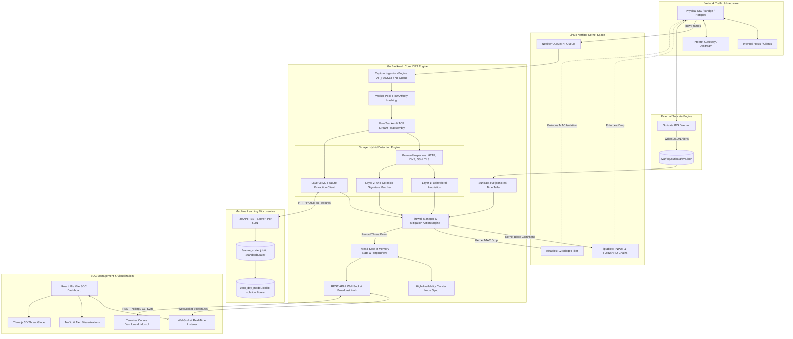
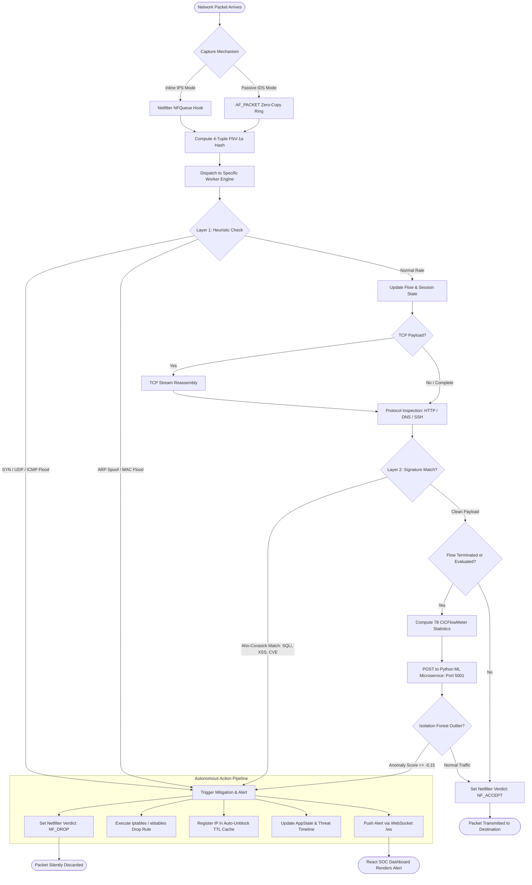
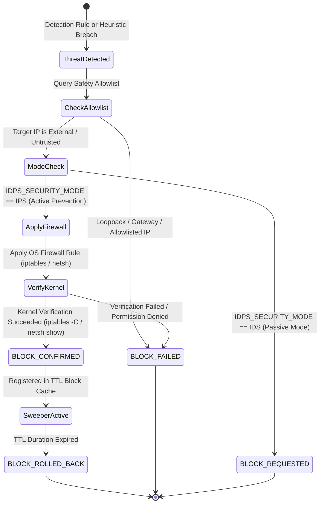

# Nexus IDPS: Comprehensive System Architecture & Engineering Reference

This document provides a complete, in-depth architectural blueprint of **Nexus IDPS** (Intrusion Detection and Prevention System). It explains every tier, module, data path, detection algorithm, and kernel-level mitigation mechanism implemented across the codebase.

---

## Table of Contents

1. [Architectural Overview & Design Principles](#1-architectural-overview--design-principles)
2. [High-Level System Architecture Diagram](#2-high-level-system-architecture-diagram)
3. [Packet Processing Lifecycle & Data Flowchart](#3-packet-processing-lifecycle--data-flowchart)
4. [Component-by-Component Breakdown](#4-component-by-component-breakdown)
   - [4.1 Network Capture & Ingestion Engine (`capture/`)](#41-network-capture--ingestion-engine-capture)
   - [4.2 Flow Tracking & TCP Reassembly Module (`flow/`)](#42-flow-tracking--tcp-reassembly-module-flow)
   - [4.3 Deep Protocol Inspectors (`inspect/`)](#43-deep-protocol-inspectors-inspect)
   - [4.4 Hybrid Multi-Layer Detection Engine (`detection/`)](#44-hybrid-multi-layer-detection-engine-detection)
   - [4.5 Machine Learning Zero-Day Microservice (`ml_server.py`)](#45-machine-learning-zero-day-microservice-ml_serverpy)
   - [4.6 External IDS Integration: Suricata Engine](#46-external-ids-integration-suricata-engine)
   - [4.7 Prevention & Dynamic Firewall Manager (`firewall/`)](#47-prevention--dynamic-firewall-manager-firewall)
   - [4.8 In-Memory State & High-Availability Sync (`state/`)](#48-in-memory-state--high-availability-sync-state)
   - [4.9 Alerting & Persistence Engine (`alert/`)](#49-alerting--persistence-engine-alert)
   - [4.10 REST API & WebSocket Communication Gateway (`api/`)](#410-rest-api--websocket-communication-gateway-api)
   - [4.11 SOC Web Dashboard & Visual Presentation (`frontend/`)](#411-soc-web-dashboard--visual-presentation-frontend)
   - [4.12 Terminal CLI Dashboard (`cmd/cli/`)](#412-terminal-cli-dashboard-cmdcli)
5. [Deployment Topologies](#5-deployment-topologies)
6. [Threat Mitigation & Response Matrix](#6-threat-mitigation--response-matrix)

---

## 1. Architectural Overview & Design Principles

Nexus IDPS is engineered as a high-throughput, sub-millisecond, hybrid intrusion detection and autonomous prevention system designed for Linux host and gateway deployments.

```
+-----------------------------------------------------------------------------+
|                               Nexus IDPS Core                               |
|                                                                             |
|  [ Ingestion ]        [ 3-Layer Hybrid Detection ]       [ Autonomous Action ]
|   AF_PACKET    ===>    Layer 1: Heuristics        ===>    iptables L3/L4    |
|   NFQueue              Layer 2: Signatures                ebtables L2 MAC   |
|                        Layer 3: Zero-Day ML               WebSocket Stream  |
+-----------------------------------------------------------------------------+
```

### Core Design Principles

1. **Sub-Millisecond In-Memory Architecture:**  
   Bypasses disk and database bottlenecks during hot-path packet analysis. All active session states, rolling packet rates, and IP blocklists reside in lock-free or read-write-optimized memory (`sync.RWMutex`).
2. **Deterministic Flow Affinity:**  
   Incoming packets are hashed using a 4-tuple FNV-1a hash (`SrcIP`, `DstIP`, `SrcPort`, `DstPort`), binding every packet of a bi-directional session to the exact same Go worker engine. This guarantees out-of-order packet reassembly without cross-worker mutex contention.
3. **Defense-in-Depth Hybrid Detection:**  
   Combines **sliding-window behavioral heuristics** (volumetric & L2 attacks), **Snort-compatible multi-pattern signature matching** (known exploits), and **Machine Learning Isolation Forest inference** (unknown zero-days).
4. **Autonomous Kernel-Level Prevention (IPS):**  
   Converts passive alerting into active defense. The system dynamically manipulates Linux Netfilter rules (`iptables` and `ebtables`) to drop malicious packets inline and isolate attacker hardware addresses without human intervention.
5. **Zero-Latency Operator Visibility:**  
   Real-time system state and threat alerts are pushed directly to a modern React-based Security Operations Center (SOC) dashboard via full-duplex WebSockets.

---

## 2. High-Level System Architecture Diagram



---

## 3. Packet Processing Lifecycle & Data Flowchart

The following flowchart illustrates the step-by-step path of a single packet as it traverses the Nexus IDPS architecture:



---

## 4. Component-by-Component Breakdown

### 4.1 Network Capture & Ingestion Engine (`capture/`)
* **Primary Files:** [`backend/capture/capture.go`](file:///home/dell/Downloads/IDPS/backend/capture/capture.go), [`backend/capture/nfqueue.go`](file:///home/dell/Downloads/IDPS/backend/capture/nfqueue.go)
* **Core Responsibilities:**
  1. **Dual Ingestion Engine:**
     * **Inline IPS Mode (`nfqueue.go`):** Connects to Linux kernel Netfilter Queues via `nfqueue-go`. Packets are held in kernel memory until Nexus IDPS issues an `NF_ACCEPT` or `NF_DROP` verdict.
     * **Passive Sniffing Mode (`capture.go`):** Uses Linux `AF_PACKET` v2 zero-copy memory ring buffers (`afpacket.NewTPacket`) with fanout mode (`afpacket.FanoutHash`) for maximum throughput without kernel-to-userspace copying overhead.
  2. **Worker Pool & Flow Affinity:**
     * Divides processing across a configurable bounded pool of `N` detection workers (`cfg.WorkerCount`).
     * Employs FNV-1a 4-tuple hashing (`hash.Write(srcIP, dstIP, srcPort, dstPort) % workerCount`). Packets belonging to the same flow are always routed to the same worker, eliminating cross-worker locking and ensuring in-order payload reassembly.

---

### 4.2 Flow Tracking & TCP Reassembly Module (`flow/`)
* **Primary Files:** [`backend/flow/tracker.go`](file:///home/dell/Downloads/IDPS/backend/flow/tracker.go), [`backend/flow/key.go`](file:///home/dell/Downloads/IDPS/backend/flow/key.go), [`backend/flow/reassembly.go`](file:///home/dell/Downloads/IDPS/backend/flow/reassembly.go)
* **Core Responsibilities:**
  1. **Flow State Management:** Tracks bi-directional communication channels using a 5-tuple key: `Protocol`, `SrcIP`, `DstIP`, `SrcPort`, `DstPort`.
  2. **TCP Stream Reassembly:** Buffers, sorts, and reconstructs out-of-order TCP segments using sequence numbers. Reassembles sliding-window application data for full payload inspection (HTTP headers, SQL injection queries, DNS records).
  3. **Statistical Flow Metric Generation:** Dynamically calculates 78 statistical features adhering to the **CIC-IDS-2017** benchmark, including:
     * Flow Duration, Inter-Arrival Times (IAT Mean, Std, Max, Min).
     * Packet Lengths (Forward/Backward Max, Min, Mean, Standard Deviation).
     * Flow Throughput (Bytes/sec, Packets/sec).
     * Flag distributions (SYN, ACK, RST, PSH, FIN, URG, ECE, CWE).

---

### 4.3 Deep Protocol Inspectors (`inspect/`)
* **Primary Files:** [`backend/inspect/http.go`](file:///home/dell/Downloads/IDPS/backend/inspect/http.go), [`backend/inspect/dns.go`](file:///home/dell/Downloads/IDPS/backend/inspect/dns.go), [`backend/inspect/ssh.go`](file:///home/dell/Downloads/IDPS/backend/inspect/ssh.go), [`backend/inspect/tls.go`](file:///home/dell/Downloads/IDPS/backend/inspect/tls.go)
* **Core Responsibilities:**
  * **HTTP Inspector:** Parses HTTP request methods, URIs, query strings, user-agents, and body contents to identify web attacks (Directory Traversal, SQLi, XSS, Remote Code Execution).
  * **DNS Inspector:** Analyzes DNS query names, record types, and transaction IDs to detect DNS tunneling (abnormally long labels), amplification attacks, and unauthorized internal DNS responses (DNS Spoofing).
  * **SSH Inspector:** Monitors authentication handshakes and rapid connection frequencies to flag credential brute-forcing.
  * **TLS Inspector:** Extracts Server Name Indication (SNI) and TLS handshake parameters without decrypting private traffic.

---

### 4.4 Hybrid Multi-Layer Detection Engine (`detection/`)
* **Primary Files:** [`backend/detection/engine.go`](file:///home/dell/Downloads/IDPS/backend/detection/engine.go), [`backend/detection/heuristic.go`](file:///home/dell/Downloads/IDPS/backend/detection/heuristic.go), [`backend/detection/ml.go`](file:///home/dell/Downloads/IDPS/backend/detection/ml.go), [`backend/detection/suricata.go`](file:///home/dell/Downloads/IDPS/backend/detection/suricata.go)
* **Core Responsibilities:**
  * **Layer 1: Behavioral Heuristics (`heuristic.go`):**
    * Operates on sliding 3-second and 10-second time windows.
    * Detects volumetric floods (SYN, UDP, ICMP), port scans, ARP spoofing (MAC count mismatches for an IP), MAC address flooding (CAM table exhaustion), DHCP starvation, and rogue DHCP server advertisements.
  * **Layer 2: Snort-Compatible Signature Engine (`rules/`):**
    * Parses official Snort/Suricata rules (`community.rules`).
    * Implements the **Aho-Corasick** multi-pattern search algorithm to evaluate reassembled stream payloads against thousands of signatures in $O(n)$ time.
  * **Layer 3: Machine Learning Client (`ml.go`):**
    * Periodically flushes completed flow statistics to the Python ML microservice via HTTP REST and evaluates the returned anomaly classification.
  * **Central Coordinator (`engine.go`):**
    * Dispatches packet data across inspectors and detection layers, correlates findings, and triggers [`triggerAlert()`](file:///home/dell/Downloads/IDPS/backend/detection/heuristic.go#L492).

---

### 4.5 Machine Learning Zero-Day Microservice (`ml_server.py`)
* **Primary Files:** [`backend/ml_server.py`](file:///home/dell/Downloads/IDPS/backend/ml_server.py), [`zero_day_model.joblib`](file:///home/dell/Downloads/IDPS/zero_day_model.joblib), [`feature_scaler.joblib`](file:///home/dell/Downloads/IDPS/feature_scaler.joblib)
* **Core Responsibilities:**
  1. Runs an asynchronous Python **FastAPI** service on port `5001`.
  2. Ingests 78-feature JSON payloads sent by the Go engine.
  3. Preprocesses and normalizes input data using `StandardScaler` (`feature_scaler.joblib`).
  4. Feeds standardized features into an **Isolation Forest** model (`zero_day_model.joblib`) trained on benign network flows.
  5. Computes decision function anomaly scores:
     * When `anomaly_score <= -0.15` and `prediction == -1`, flags the flow as a **Zero-Day Anomaly** with high confidence.

---

### 4.6 External IDS Integration: Suricata Engine
* **Primary File:** [`backend/detection/suricata.go`](file:///home/dell/Downloads/IDPS/backend/detection/suricata.go)
* **Core Responsibilities:**
  * Runs concurrently with Suricata inline or passive daemon.
  * Tunnels alerts from `/var/log/suricata/eve.json` in real time using a non-blocking file tailer.
  * Normalizes Suricata severity codes (1–4) into Nexus unified categories (`Critical`, `High`, `Medium`, `Low`).
  * Injects parsed Suricata events into the Nexus prevention pipeline, allowing Suricata detections to trigger immediate kernel firewall blocks and UI updates.

---

### 4.7 Prevention & Dynamic Firewall Manager (`firewall/`)
* **Primary File:** [`backend/firewall/firewall.go`](file:///home/dell/Downloads/IDPS/backend/firewall/firewall.go)
* **Core Responsibilities:**
  1. **Layer 3/4 IP Blocking (`iptables` / `ip6tables`):**
     * Inserts immediate `DROP` rules into the `INPUT` and `FORWARD` chains for malicious IPs with an identifier comment (`IDPS-BLOCK`).
  2. **Layer 2 MAC Blocking (`ebtables`):**
     * Essential for gateway and Wi-Fi hotspot deployments. Blocks malicious MAC addresses directly on bridge interfaces, preventing attackers from bypassing IP blocks by obtaining a new DHCP lease or attacking peer clients on the same local subnet.
  3. **Safety Filters (`isSafeToBlock`):**
     * Strictly protects loopback addresses (`127.0.0.1`, `::1`), default gateways, local interface IPs, and multicast subnets (`224.0.0.0/4`) from accidental isolation.
  4. **TTL Sweeper & Auto-Unblock Goroutine:**
     * Tracks temporary bans in an in-memory TTL map. A background goroutine cleans up expired kernel firewall rules after the ban period (e.g., 300 seconds), restoring normal access automatically.

---

### 4.8 In-Memory State & High-Availability Sync (`state/`)
* **Primary Files:** [`backend/state/state.go`](file:///home/dell/Downloads/IDPS/backend/state/state.go), [`backend/state/hasync.go`](file:///home/dell/Downloads/IDPS/backend/state/hasync.go)
* **Core Responsibilities:**
  * Maintains the global `AppState` protected by `sync.RWMutex`:
    * Real-time packet and bandwidth counters.
    * Protocol distribution counters (TCP, UDP, ICMP, ARP, Other).
    * Active Blocked IPs and Blocked MACs lists.
    * Ring-buffered recent alerts and timeline event logs.
  * **High-Availability (HA) Sync (`hasync.go`):**
    * Enables multi-node cluster synchronization, propagating blocked IPs and active threats across multiple gateway nodes.

---

### 4.9 Alerting & Persistence Engine (`alert/`)
* **Primary Directory:** [`backend/alert/`](file:///home/dell/Downloads/IDPS/backend/alert/)
* **Core Responsibilities:**
  * **Structured JSON Logging:** Persists alert history to `alerts.json` for external SIEM integration (Elasticsearch, Splunk).
  * **Embedded SQLite Database:** Stores historical incident logs in `alerts.db` for queries, forensic reporting, and historical trend analysis.

---

### 4.10 REST API & WebSocket Communication Gateway (`api/`)
* **Primary File:** [`backend/api/api.go`](file:///home/dell/Downloads/IDPS/backend/api/api.go)
* **Core Responsibilities:**
  * Serves HTTP REST endpoints on port `8000`:
    * `GET /api/status`: Current engine operational metrics and packet counts.
    * `GET /api/alerts`: Historical alert records with pagination and search.
    * `GET /api/blocked`: Currently active IP and MAC blocks.
    * `POST /api/firewall/unblock`: Manual administrative unblock requests.
    * `POST /api/whitelist`: Trusted IP management.
  * **WebSocket Hub (`/ws`):**
    * Pushes live state snapshots to all connected web clients every 500ms and immediately upon any critical threat event.
    * Secures connections via optional `X-API-Key` or WebSocket subprotocol token.

---

### 4.11 SOC Web Dashboard & Visual Presentation (`frontend/`)
* **Primary Files:** [`frontend/src/App.tsx`](file:///home/dell/Downloads/IDPS/frontend/src/App.tsx), [`frontend/src/components/Dashboard.tsx`](file:///home/dell/Downloads/IDPS/frontend/src/components/Dashboard.tsx), [`frontend/src/components/AttackDetectionView.tsx`](file:///home/dell/Downloads/IDPS/frontend/src/components/AttackDetectionView.tsx)
* **Core Responsibilities:**
  * Built with **React 18**, **TypeScript**, **Vite**, and **Tailwind CSS**.
  * **Zero-Polling Real-Time Streaming:** Consumes live telemetry via custom hook [`useWebSocket.ts`](file:///home/dell/Downloads/IDPS/frontend/src/hooks/useWebSocket.ts).
  * **Telemetry & Visualization:**
    * Traffic throughput and bandwidth area charts using **Recharts**.
    * Threat severity donut meters and protocol distribution charts.
    * Real-time interactive attack matrix displaying active attack vectors, target IPs, and mitigation actions.
    * Interactive 3D WebGL cyber background using **Three.js** ([`ThreeDBackground.tsx`](file:///home/dell/Downloads/IDPS/frontend/src/components/ThreeDBackground.tsx)).
  * **Firewall Controls:** Allows SOC analysts to review active blocks and trigger one-click manual unblocks directly from the browser.

---

### 4.12 Terminal CLI Dashboard (`cmd/cli/`)
* **Primary File:** [`backend/cmd/cli/main.go`](file:///home/dell/Downloads/IDPS/backend/cmd/cli)
* **Core Responsibilities:**
  * Curses-style terminal dashboard (`idps-cli`) for headless servers, cloud VMs, and SSH sessions.
  * Renders live ASCII bar charts, recent detection streams, and system resource metrics without requiring a browser.

---

## 5. Deployment Topologies

Nexus IDPS supports three distinct deployment modes configured via `backend/.env`:

```
Mode 1: Inline Gateway Mode (Full IPS Defense)
[ Internet / WAN ] <===> (eth0) [ Nexus IDPS Gateway ] (eth1 / wlan0) <===> [ LAN Devices ]
                                        |
                          - Linux Bridge / NAT Forwarding
                          - ebtables L2 Isolation
                          - iptables L3/L4 Dropping

Mode 2: Host Protection Mode (Single Endpoint)
[ Untrusted Network ] <===> (eth0) [ Host Server running Nexus IDPS ]
                                        |
                          - Local INPUT Netfilter Queue
                          - Direct Server Defense

Mode 3: Passive Network Sniffer (IDS Mode)
[ Network Switch ] ---> (SPAN / Mirror Port) ---> (eth0) [ Nexus IDPS Monitor ]
                                                                 |
                                                   - AF_PACKET Zero-Copy Sniff
                                                   - Alerting & Dashboard Stream
```

1. **Inline Gateway Mode (`IDPS_DEPLOYMENT_MODE=GATEWAY`, `IDPS_SECURITY_MODE=IPS`):**
   * Placed between WAN (`eth0`/`usb0`) and LAN (`eth1`/`wlan0`).
   * Evaluates all transit packets. Malicious traffic is discarded inline via Netfilter Queues and blocked via `ebtables`/`iptables`.
2. **Host Protection Mode (`IDPS_DEPLOYMENT_MODE=HOST`):**
   * Installed directly on a mission-critical server (web, database).
   * Guards the server's `INPUT` chain against port scans, brute force, and exploits.
3. **Passive Sniffer Mode (`IDPS_SECURITY_MODE=IDS`):**
   * Attached to a switch SPAN/mirror port.
   * Silently monitors network traffic without packet delays or kernel drops, generating alerts for security auditing.

---

## 6. Threat Mitigation & Response Matrix

| Attack Category | Specific Vector | Detection Layer | Engine / Mechanism | Preventive Action Taken |
| :--- | :--- | :--- | :--- | :--- |
| **Denial of Service** | SYN Flood | Layer 1 | `heuristic.go` (SYN rate threshold) | `iptables -j DROP` + NFQueue drop |
| **Denial of Service** | UDP Flood | Layer 1 | `heuristic.go` (UDP packet rate) | `iptables -j DROP` |
| **Denial of Service** | ICMP Flood / Ping of Death | Layer 1 | `heuristic.go` (ICMP rate & MTU bounds) | `iptables -j DROP` |
| **Reconnaissance** | Port Scan (TCP SYN / Connect) | Layer 1 | `heuristic.go` (Unique port/time ratio) | `iptables -j DROP` |
| **Reconnaissance** | ICMP Network Sweep | Layer 1 | `heuristic.go` (Target host diversity) | `iptables -j DROP` |
| **Layer 2 Infrastructure** | ARP Cache Poisoning | Layer 1 | `heuristic.go` (IP-to-MAC mismatch) | `ebtables -j DROP` (MAC isolation) |
| **Layer 2 Infrastructure** | MAC Flooding / CAM Exhaustion| Layer 1 | `heuristic.go` (New MAC/sec rate) | `ebtables -j DROP` |
| **Layer 2 Infrastructure** | Rogue DHCP Server | Layer 1 | `heuristic.go` (Unauthorized DHCP OFFER)| `ebtables -j DROP` |
| **Web Applications** | SQL Injection (`UNION SELECT`) | Layer 2 | `rules/` + `inspect/http.go` (Snort SID)| Immediate connection reset / drop |
| **Web Applications** | Cross-Site Scripting (XSS) | Layer 2 | `rules/` + `inspect/http.go` | TCP stream drop + source block |
| **Authentication** | SSH Brute Force | Layer 1 & 2 | `inspect/ssh.go` (Rapid failed handshakes) | `iptables -j DROP` (Port 22 block) |
| **Protocol Abuse** | DNS Tunneling & Amplification | Layer 1 & 2 | `inspect/dns.go` (Payload size & query) | `iptables -j DROP` (Port 53 block) |
| **Zero-Day Attacks** | Unknown / Stealth Anomalies | Layer 3 | `ml_server.py` (Isolation Forest) | Automated quarantine ban |
| **Deep Packet Exploits**| CVE Signatures / Malware C2 | External | Suricata Engine (`eve.json` tailer) | Dynamic rule propagation to `iptables` |

---

## 7. Cross-Platform Networking Architecture (Linux vs Windows)

Nexus Enterprise IDPS uses a modular adapter architecture behind unified interfaces (`PlatformCapture`, `PlatformFirewall`, and `PlatformCapabilities`):

```
+-----------------------------------------------------------------------------------+
|                        Unified Detection & Flow Engine                            |
+-----------------------------------------+-----------------------------------------+
                                          |
                +-------------------------+-------------------------+
                |                                                   |
      [ Linux Adapter ]                                   [ Windows Adapter ]
  - Capture: AF_PACKET Zero-Copy Ring                 - Capture: Npcap / WinPcap NDIS 6
  - Inline: Netfilter Queue (NFQueue)                 - Inline: WFP / Inbound Stream Div
  - L3/L4 Firewall: iptables / nftables               - L3/L4 Firewall: netsh advfirewall
  - L2 Filter: ebtables MAC isolation                 - L2 Filter: ARP Table Eviction
  - Verification: iptables -C rule check              - Verification: netsh show rule
  - Flow Termination: TCP RST Packet Injection        - Flow Termination: Native TCP Disconnect
```

### 7.1 Linux Networking Engine
* **Capture Layer (`capture/capture_linux.go`)**: Uses `afpacket.NewTPacket` with `tpacket` ring buffer. Direct memory access eliminates per-packet syscall overhead.
* **Inline Engine (`capture/nfqueue.go`)**: Binds to Netfilter Queue (queue num 0). Packets are inspected before kernel forwarding. If an attack is detected, the packet verdict is issued as `NF_DROP`.
* **Firewall Layer (`firewall/firewall_linux.go`)**: Injects rules with unique comment tags (`IDPS-BLOCK`, `IDPS-NAT`, `IDPS-NFQ`). Verified via `iptables -C` before reporting success.

### 7.2 Windows Networking Engine
* **Capture Layer (`capture/capture_windows.go`)**: Interfaces with Npcap NDIS 6 driver via `pcap_open_live`. If Npcap is not installed, gracefully falls back to Windows raw sockets with `SIO_RCVALL` promiscuous binding.
* **Firewall Layer (`firewall/firewall_windows.go`)**: Injects inbound and outbound blocking rules via Windows Advanced Firewall (`netsh advfirewall firewall add rule name="IDPS-BLOCK-<ip>" dir=in/out action=block remoteip=<ip>`).
* **Verification Layer**: Executes `netsh advfirewall firewall show rule name="IDPS-BLOCK-<ip>"` to verify rule existence in the Windows kernel filtering table.
* **Flow Termination**: Native TCP flow disconnection using PowerShell `Get-NetTCPConnection` and `Stop-Process` or TCP RST injection.

---

## 8. Verified Prevention State Machine & Enterprise Security

### 8.1 Prevention State Machine



### 8.2 Reproducible Performance Benchmarks

Measured on Intel(R) Core(TM) i3-6006U CPU @ 2.00GHz (64-bit Linux) via `go test -bench . -benchmem`:

* **Packet Decoding Latency**: **553.4 ns/op** (~1.8 million packets/sec)
* **Flow Table Tracking Latency**: **1,681.0 ns/op** (594,000 updates/sec, **0 heap allocations/op**)
* **Signature Evaluation (Aho-Corasick)**: **4,533.0 ns/op** (220,000 rule evaluations/sec)
* **Heuristic Anomaly Inspection**: **2,265.0 ns/op** (441,000 heuristic checks/sec)
* **Concurrent Multi-Worker Load**: **82,980 packets/sec** across 8 concurrent goroutines.

---

*Document updated for **Nexus Enterprise IDPS v2.0** — Cross-Platform Production Architecture.*
